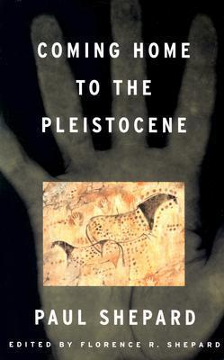
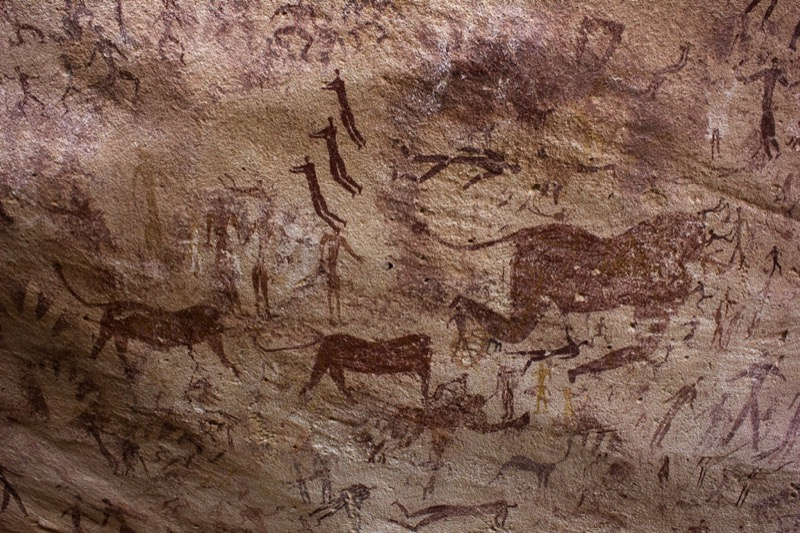
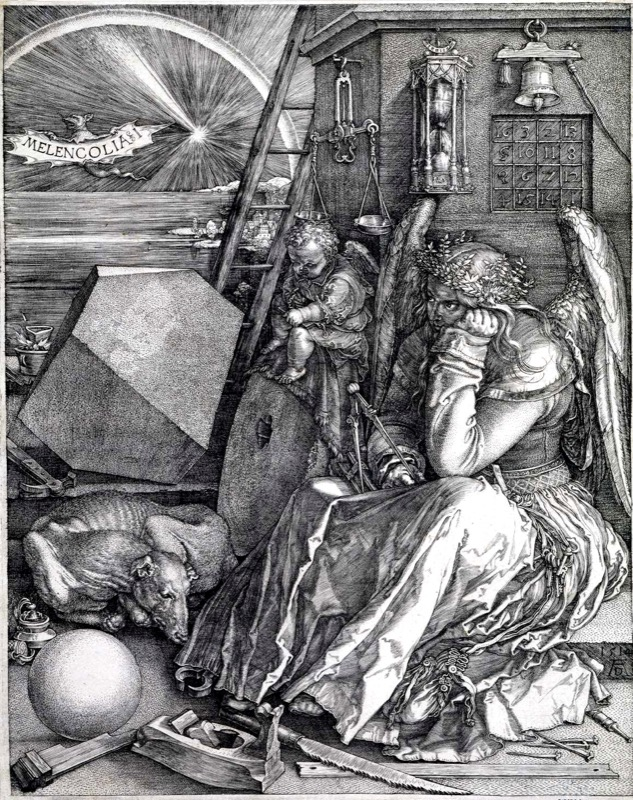

## Our genes may hold solutions to modern-world problems

{fig-alt="Book cover: Coming Home to the Pleistocene by Paul Shepard, over a pale handprint with a cave painting of spotted horses set into the palm." width=240}

- Coming Home to the Pleistocene, Paul Shepard (1998). Passages from this book added a new point to my research background

## Our default mode fights the systems we built

::: {.panel-tabset}

### Presentation

- Humans store information from way back. Modern problems frustrate us because our genes, heart and rationality run on that old default
- Loneliness and a lack of true community are major problems today. Homophily-based circles deepen segregation and exclusion

### Detailed

Full text from the 21 Oct draft:

- Humans store information from way back, when we emerged in the later stages of Earth's history
- Modern problems often frustrate us. That frustration signals that our default mode (genes, heart, rationality) is fighting the systems we built
- Loneliness and a lack of true community are major problems for individuals today. Homophily-based circles deepen segregation and exclusion: people team up only with others like them, so the system cannot guide "new" people as they move from one life stage to the next

:::

## Healthy development needs diverse relationships

::: {.panel-tabset}

### Presentation

- Relationships appear as chains of interaction, kinship, dependence, cooperation and compliance (Searles, 1960)
- Hunter-gatherer adults grounded youths in the natural world, then monitored and celebrated their transition into adulthood

### Detailed

Full text from the 21 Oct draft:

- Healthy personal development needs relationships with others. A diverse environment makes the self ever more unique and yet more fully bonded to others. These relationships appear as chains of interaction, kinship, dependence, cooperation and compliance (Searles, 1960)
- In foraging and hunter-gatherer communities, adults grounded youths in the natural world early, then monitored and celebrated their transition into adulthood. This helped youths understand their ideals, their roles and their spiritual experiences within the circle of life

:::

## Prehistoric people interacted widely; today many are excluded

::: {layout-ncol=2}
{fig-alt="Rock painting in reddish brown showing many small human figures among large animals such as cattle."}

{fig-alt="Engraving of a winged figure resting her head on her fist among tools, a sleeping dog, a polyhedron and an hourglass."}
:::

- Left: people learned from and taught each other and had equal opportunities despite their different roles
- Right: today many people are segregated and excluded

## Diverse social interaction is essential to decision models

::: {layout-ncol=2}
{fig-alt="Rock painting in reddish brown showing many small human figures among large animals such as cattle."}

.](figures_20261028/2026-10-21_coffeehouse.jpg){fig-alt="Engraving of an Ottoman coffeehouse: men sit on a raised platform along windows that look out on the sea, with a fountain in the middle of the room."}
:::

- Ideally, we would socialize like this

## One reviewer cannot screen 1,061 records

- Stream B took more than 15 hours for 254 records, about 3.6 minutes each
- At that pace the 807 unscreened records in Streams A and C need about 48 hours
- Levers: combine phrases, limit document types, restrict language
- Losing some seeds is acceptable, because citation chaining recovers them

## Proposed cut: 1,061 records fall to about 630

| Rule | Records cut |
| --- | --- |
| Review articles | 25 |
| Editorials, errata, books | 11 |
| Non-English | 23 |
| A and C conference papers, book chapters | 98 |
| A: no network word | 68 |
| C: no SAOM or REM phrase | 100 |
| A: "social interaction" only in the abstract | 41 |
| B v3: location, activity and other non-tie prediction | about 60 |

## The cut leaves 305 records to decide

- Streams A and C keep 441 records; Stream B keeps about 190
- Records still to decide fall from 807 to 305
- The C rule costs the most: 7 of 11 sampled records it removes were on-topic under my stream question
- Every excluded record stays in the sheet with its reason, so I can rescue it

## Stream B returned mostly location prediction

- Most papers study location-based social networks such as Path or Foursquare. Many predict the next location, and some use social interaction as a feature
- Few papers infer a friendship or link from mobility data
- ResearchRabbit, started from the same seeds, returned more insightful titles
- Group feedback (26 Oct): co-location is a proxy for a tie, and LBSN data mixes online and offline interaction

## Idea 1: reverse the location prediction

- GPS traces are the realization of a location choice. Reversing the prediction may reveal the social interaction behind the "next" location
- Example: a visit to a place new to the data after a co-stay with a person at a regular place, or a longer-than-average meeting with a "new" person, suggests a high tie strength
- Open question: many scenarios could serve as rules. Can an algorithm detect them instead of me freezing them as rules?

## Idea 2: can link prediction act as choice behavior?

- Choice set: friends, not friends, tie strength
- Features: duration, frequency, proximity, other geo features

## Screening can finish on Wed 4 Nov

| Date | Work |
| --- | --- |
| Thu 29 Oct to Wed 4 Nov | Screen 305 records in blocks of 40 (G2 on Wed 4 Nov) |
| Fri 30 Oct | Run B v3 (half a day) |
| Thu 5 to Fri 13 Nov | Extraction (G3 moves to Fri 13 Nov) |
| Fri 20 Nov | Draft to Sensei |

- Decision for the draft date: cap N near 30, or move the draft to Fri 27 Nov
