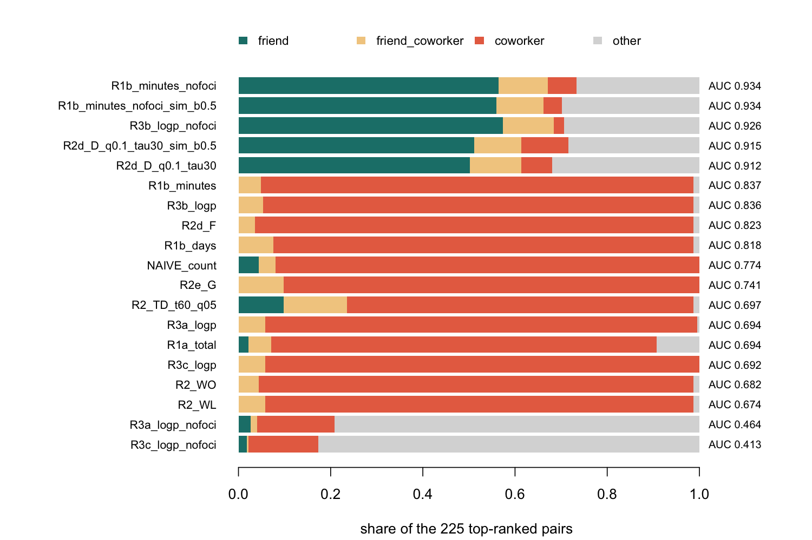

## 1. Current Situation or Progress since Last Week

### Systematic Literature Review

#### What I planned

-

#### What I did

-

#### What obstacles I found

-

#### What I am currently doing

-

#### What I am going to do next

-

### Inferring Social Ties from GPS Data

#### What I planned

- Work out how to tell friendship from plain proximity (feedback from the 2 Nov group meeting)
- Run the methods on the real GPS data, after the checks on the simulated city pass

#### What I did

- Tested a fix for the proximity problem on the simulated city: remove the time two people share at a common workplace, or at their own home (the shared-foci filter)
    - Among the 225 top-ranked pairs, the share of true ties rises from 5 to 67 percent for the co-stay minutes count
- Compared the full set of methods, from plain counts to tests against chance, on the same city
    - Count-based methods fill 90 to 95 percent of their top-ranked pairs with coworkers who are not friends
- Estimated the social effect on each inferred network and on the true network
    - Every inferred network pulls the estimate below the true value (bias -0.28 to -0.46, against -0.03 on the true network)
    - With no true effect, the standard test (Wald) finds one in 41 percent of fits on the true network. The likelihood ratio test finds one in 10 percent
- Added a second test (likelihood ratio), built the last method variants, and built a check of how missed and false ties in the network shift the estimate
- Merged the three code branches and reran everything with 60 random seeds (30 for the last check)

#### What obstacles I found

-

#### What I am currently doing

- Studying the method ladder with an AI-assisted teaching deck built from the method guide and the code. It flags the 12 design choices that wait for my sign-off

#### What I am going to do next

- Decide how to treat estimates outside the valid range (see Points of Discussion)
- Run the methods on the real GPS data, after the checks on the simulated city pass

## 2. Points of Discussion

### What I want to confirm

- The shared-foci filter is my own design: no paper I read proposes it. I tested it on a simulated city where home and work places are detected without error. I want to confirm that I can report it as a design choice tested on simulated data, and state its behaviour on real data as a limit.

### What obstacles I cannot decide on my own

- How to treat estimates of the social effect that fall outside the valid range (absolute value of 1 or more). In the 60-seed run, 20 percent of the fits on the true network and 35 to 58 percent of the fits on the inferred networks fall outside. The model has no unique solution there, and neither test I use handles these fits. Two routes: change the estimator (constrain the effect to the valid range) or enlarge the simulated city. Type of stuck:
    - not enough knowledge, because I do not know which remedy the literature on this model accepts.
- Whether the check of missed and false ties in the network belongs in Paper 1, as measurement error in the network, or in Paper 2, which asks how much the estimate depends on the method that builds the network. Type of stuck:
    - cannot choose between two scopes, because both fit the check.

## 3. Definitions of Terms

::: {.table-scroll tabindex="0" role="region" aria-label="Definitions of terms"}
| Term        | Definition                                                                 |
| ----------- | -------------------------------------------------------------------------- |
| Stream A    | Choice modeling affected by social interactions or peer-effects            |
| Stream B    | Social ties or social networks inference from GPS Data                     |
| Stream C    | Dynamic networks                                                           |
| Social ties | Links or relationship between one person to another in a specific settings |
| GPS Data    | Movement tracking data obtained by providers                               |
| Title and abstract screening | First pass over the records: I read only the title and abstract and mark each record include, unsure or exclude. |
| Full text screening | Second pass: I read the whole paper and decide whether it meets the inclusion criteria of the review. |
| Citation chaining | Finding further papers by following the reference lists of known papers (backward) and the papers that cite them (forward). |
| Filter rules | Fixed rules that remove records before anyone reads them, for example by document type, language or missing key words. Every removed record stays in the sheet with its reason. |
| PRISMA 2020 | A reporting guideline for systematic reviews. It lists what a review should report, such as the sources searched, the screening method and a flow diagram of record counts. |
| Cohen's kappa | A measure of agreement between two screening passes that removes the agreement expected by chance. 1 is perfect agreement and 0 is chance level. |
| Shared visit (co-location) | Two people recorded at the same place in the same time window. |
| Proximity versus friendship | Proximity means two people are near each other. Friendship needs more, because coworkers share a place every day without being friends. |
| Stochastic actor-based model | A model of how a network changes over time: each person adds, keeps or drops ties in small steps, and the model estimates the rules behind those choices. |
| GPS fix | One row of GPS data: who, where and when. Example: at 08:03 on Monday, phone 17 reports a position near the school gate. |
| Stay | A period of 20 minutes or more within 100 m of one spot, such as a work day at a desk. |
| Place | A group of stays that lie within 100 m of each other. Ahmad's Monday stay and Tuesday stay at the office form one place. |
| Co-stay | The overlap of two people's stays at one place, kept from 5 minutes. Ahmad at a restaurant from 19:00 to 21:00 and Carlos from 19:30 to 21:15 give a co-stay of 90 minutes. |
| Shared focus | A place that structures a person's routine, here the home or the workplace. A co-stay at a shared workplace says that two people share a timetable. It says little about friendship. |
| Shared-foci filter | My design: delete the co-stays at a workplace both people share, and the visits to a person's own home and work place, then score what remains. |
| Place popularity | A ramen shop near the station draws half the town, so two strangers overlap there often. Location entropy measures it: it rises with the number of distinct visitors. |
| Coworker trap | A method that counts co-presence ranks coworkers, who share an office all week, above friends who meet once a week. |
| Popularity trap | A method that counts co-presence ranks strangers at busy places above friends who meet at quiet ones. |
| Method ladder, rung | The methods ordered by how much context they use. R1 counts the overlap, R2 weights it by context, R3 tests it against a random model. R4 (reconstruction with error) is pending. Every rung gives each pair one tie score. |
| Null model | A model of what random visits would produce. A pair's overlap counts as a tie signal only when it exceeds what the null model expects. Example: 10 places in town, Ahmad visits 4 and Carlos visits 3, all 3 of Carlos's places among Ahmad's: random visits give that in 3.3 percent of draws. |
| Cell (C00, C10, C01, C11) | One combination of method strength (base or strengthened) and data used (GPS only, or GPS plus age band and gender). C10 uses the shared-foci filter. |
| Network W | A matrix with one row per person. The row holds the weights of that person's peers and sums to 1, so W times the choices gives the average choice of the peers. |
| Social effect (gamma) | How much a person's yes-or-no choice follows the average choice of their peers in W (Lee, Li and Lin 2014). The simulated true value is 0.5. |
| AUC | The chance that a true tie picked at random scores higher than a non-tie picked at random. 0.5 is chance and 1 is perfect. |
| Precision at k | The share of true ties among the k top-ranked pairs. Here k is 225, the number of true ties. |
| Bias | The mean estimate of the social effect minus its true value of 0.5. |
| Coverage | The share of 95 percent intervals that contain the true value. A sound interval covers 0.95 of the time. |
| Monte Carlo standard error | The spread of the estimates over the seeds divided by the square root of the number of fits. A bias inside two of these cannot be told from zero. |
| Wald test, likelihood ratio test | Two tests of whether the social effect differs from 0. Wald divides the estimate by its standard error. The likelihood ratio test fixes the effect at 0, refits, and compares the two fits. |
| Out-of-bound fit | An estimate with an absolute value of 1 or more. The model has a unique solution only below that bound for a row-normalised W. |
| Perturbed W | The true network with a share r of its ties kept (recall) and false ties added until a share p of the ties is true (precision). Example: keep 8 of 10 true ties and add 2 false ones, so r is 0.8 and p is 0.8. |
| Seed, smoke run | A seed fixes a random draw, so two runs with the same seed give the same output. A smoke run uses very few seeds to check that code works. |
| SOURCED, DESIGN, PENDING | SOURCED: from a paper I read in full. DESIGN: my own choice, with a default and a range I test. PENDING: source not yet verified, no code. |
:::

## 4. Computational Results or Figures (if any)

The simulated city has 150 people, 28 days and 225 planted friendships. Every number below comes from the run of 9 November 2026 on my Mac, on the private GitHub repository [paper1_gps_network_choice](https://github.com/rizqrama/paper1_gps_network_choice): `scripts/run_all.R est_seeds=60 null_seeds=60` and `scripts/run_perturbation.R 30`, code of commit `47eece5`. Results are exploratory.

### How well each method finds the planted ties

::: {.table-scroll tabindex="0" role="region" aria-label="Network recovery of the naive count, one count method and the best method of each cell"}

:::

{fig-alt="Horizontal stacked bars, one per method. Each bar splits the 225 top-ranked pairs into friend, friend_coworker, coworker and other shares. Count-based methods such as the naive count, R1b minutes, R2d F and R2e G fill the top with coworker pairs. Methods with the shared-foci filter and the place diversity D fill it with friend and friend_coworker pairs."}

### What the estimate of the social effect does on each network

True value 0.5, 60 seeds per row.

::: {.table-scroll tabindex="0" role="region" aria-label="Estimate of the social effect by network"}

:::

Every inferred network lies below 0.5 by more than two Monte Carlo standard errors, and C10, the network with the best friend recovery, shows the largest bias. In a second experiment with a true effect of 0, the Wald test claims an effect in 41 percent of the fits on the true network and 48 to 57 percent on the cells, where a sound test claims one in 5 percent. The likelihood ratio test rejects in 10 percent of the true-network fits and 0 to 15 percent of the cell fits. Out-of-bound fits make up 20 percent of the true-network fits and 35 to 58 percent of the inferred-network fits.

### What missed and false ties in the network do to the estimate

{fig-alt="Two panels, false ties at random and false ties from coworker pairs. Each panel plots the bias of the estimate against recall from 0.6 to 1, with one line per precision of 1, 0.8 and 0.6 and bars of two Monte Carlo standard errors. Four diamonds mark the cells C00, C01, C10 and C11 at recall 0.72 to 0.81, with biases of -0.28 to -0.46."}

Missed ties move the bias little, and false ties move it more. The largest bias, -0.648, comes with 20 percent of the true ties missed and 40 percent of the ties false, the false ties joining coworkers. The grid stops at precision 0.6, while the four cells sit at precision 0.30 to 0.32, so it cannot say whether their bias comes from low precision.

## 5. Supplementary Materials

### Systematic literature review

### Network inference from GPS traces

[Supplementary material: network inference from GPS traces](20261111/supplementary.qmd). It explains the workflow, each method and the results step by step, with a diagram of the general workflow, the method ladder, the four cells and the estimation loop.

## 6. Feedbacks and Additional Follow-ups

- [ ]
- [ ]
- [ ]
