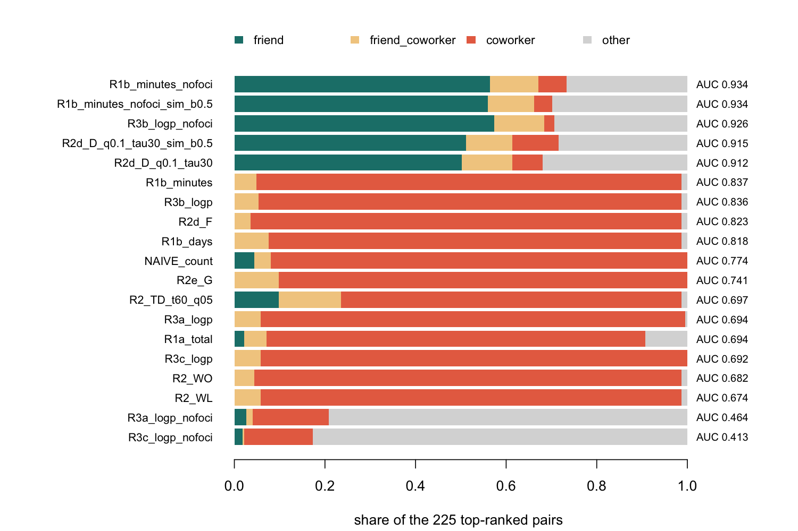
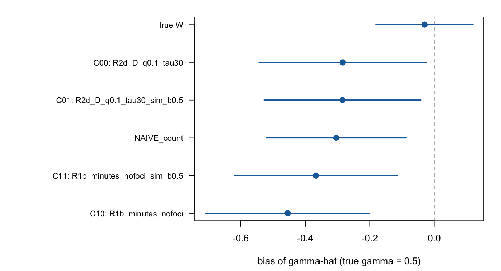

::: {.callout-warning title="The results on this page are questionable"}
The results from the toy model and toy data need to be double-checked. They may be too good to be true because of the "perfect" generated city.
:::

## How to read this page

This page explains the work behind the [progress report of 2026-11-11](../20261111.qmd) from the first step. It follows the benchmark report in the code repository (`report/network-inference-report.qmd`) and keeps its methods, results and gaps. Each method gets a plain sentence and an example first. The formula, the source paper and the page sit in a collapsed box under the example. Click the box to open it.

Three labels tell you how far to trust a step.

- **SOURCED**: the equation or default comes from a paper I read in full, and I note the page.
- **DESIGN**: my own choice, because no paper states it. Each DESIGN item has a default and a range of values I test.
- **PENDING**: the source text is not yet verified, so no code exists. Only rung R4 carries this label.

Ground rules for every number below:

- The data come from a simulated city where the true ties are known. No real GPS data appears here. The real data stays on my machine.
- Every result is exploratory: one city of 150 people. The estimation results use 60 random seeds of the choice draw, and the perturbation experiment uses 30.
- The numbers come from the run of 9 November 2026 on my Mac (Apple M1, 8 cores): `scripts/run_all.R est_seeds=60 null_seeds=60`, then `scripts/run_perturbation.R 30`, on the code of commit `47eece5` of the private repository [paper1_gps_network_choice](https://github.com/rizqrama/paper1_gps_network_choice).

::: {.callout-note collapse="true" title="Symbols used on this page"}
::: {.table-scroll tabindex="0" role="region" aria-label="Symbols used on this page"}
| Symbol | Meaning |
| ------ | ------- |
| $i$, $j$, $u$ | persons |
| $l$ | a place |
| $n_u(l)$ | number of visits of person $u$ at place $l$ |
| $H_l$ | entropy of place $l$: high for a place many different people visit |
| $D$ | diversity: the effective number of different times or places in which a pair met |
| $p$ | p-value: the chance of an overlap this large or larger if visits were random |
| $W$ | the network matrix: row $i$ holds the weights of person $i$'s peers and sums to 1 |
| $\gamma$ | the social-interaction effect: how much a person's choice follows the average choice of their peers |
| $\hat\gamma$ | the estimate of $\gamma$ |
:::
:::

## The problem in one example

Picture two office workers, Ahmad and Bob. Their phones log GPS fixes all day. Ahmad and Bob sit in the same building from nine to five, so their traces overlap for about 40 hours a week. Ahmad and Carlos meet for dinner at a quiet restaurant once a week, so their traces overlap for two hours. A survey would say that Ahmad and Carlos are friends and that Ahmad and Bob are colleagues who never speak. A method that reads only the traces must recover that answer.

Paper 1 estimates the social-interaction effect of Lee, Li and Lin (2014): a person's yes-or-no choice, such as driving a child to school, depends on the average choice of the people in their network $W$. The usual source of $W$ is a survey of ties. This page covers what happens when a researcher infers $W$ from GPS traces instead, and where the methods in the literature fall short.

### Three ideas that recur

**Co-stay.** Ahmad stays at the restaurant from 19:00 to 21:00 and Carlos from 19:30 to 21:15. The two stays overlap for 90 minutes at one place. A co-stay is the overlap of two persons' stays at the same place, kept when it lasts at least 5 minutes.

**Shared focus.** Ahmad and Bob share a workplace, and Ahmad also shares a home with a flatmate. A shared focus is a place that structures a person's routine, here the home and the workplace. A co-stay at a shared focus says that two persons share a timetable. It says little about friendship.

**Place popularity.** A ramen shop near the station draws half the town at lunch. Two strangers who both eat there overlap often. The popularity of a place is its share of all visits. A measure called location entropy rises with the number of distinct visitors.

### Two traps follow

- **Coworker trap.** A method that counts co-presence ranks colleagues above friends.
- **Popularity trap.** A method that counts co-presence ranks strangers at busy places above friends who meet at quiet ones.

## The general workflow

::: {.diagram-scroll tabindex="0" role="region" aria-label="General workflow from GPS fixes to the estimate of the social effect, scrolls sideways"}
```{mermaid}
%%{init: {"flowchart": {"useMaxWidth": false}, "themeVariables": {"lineColor": "#8c7a5b", "arrowheadColor": "#8c7a5b"}}}%%
flowchart LR
  accTitle: Workflow from GPS fixes to the estimate of the social effect
  accDescr {
    A main chain from left to right. GPS fixes hold who, where and when. Stays are periods of at least 20 minutes at one spot. Places and co-stays join stays that sit close together and find overlapping time. A tie score is one number per pair of people and method. The network W keeps the five strongest ties of each person and scales each row to sum to 1. The choice model estimates the social effect gamma. Home and work places of each person feed a shared-foci filter before the tie score. Two inputs feed the chain with dashed lines: papers, sorted into method groups, show which methods to try, and a simulated city with known ties produces the GPS fixes. Two checks close the chain: the tie scores are scored against the true ties, and the estimate of gamma is compared with the true gamma. Real GPS data is a planned input. Everything except the real data and rung R4 is done on the simulated city.
  }
  G["GPS fixes<br/>who, where, when"]
  ST["Stays<br/>a spot where a person<br/>stays 20 minutes or more"]
  PL["Places and co-stays<br/>same place,<br/>overlapping time"]
  AN["Home and work<br/>of each person"]
  SC["Tie score<br/>one number per pair<br/>and method"]
  W["Network W<br/>top 5 ties per person,<br/>rows sum to 1"]
  CM["Choice model<br/>estimate gamma,<br/>the social effect"]
  LIT["Papers<br/>sorted into<br/>method groups"]
  SIM["Simulated city<br/>true ties known"]
  CK1["Check 1<br/>score against<br/>the true ties"]
  CK2["Check 2<br/>compare gamma-hat<br/>with the true gamma"]
  REAL["Real GPS data<br/>stays on my machine"]
  R4["R4 reconstruction<br/>with error<br/>sources unverified"]

  G --> ST --> PL --> SC --> W --> CM
  ST --> AN
  AN -.->|"shared-foci filter"| SC
  LIT -.->|"which methods to try"| SC
  SIM -.->|"generates"| G
  SC --> CK1
  CM --> CK2
  REAL -.->|"planned"| G
  R4 -.->|"planned"| SC

  classDef done fill:#4d768a,stroke:#222,color:#fff
  classDef next fill:#f4ecd2,stroke:#222,stroke-dasharray:6 5,color:#222
  class G,ST,PL,AN,SC,W,CM,LIT,SIM,CK1,CK2 done
  class REAL,R4 next
  linkStyle default stroke:#8c7a5b,stroke-width:2px
```
:::

Blue: done on the simulated city. Dashed: not done yet. Real data and rung R4 are the two open parts.

## The simulated city

Real friendships are unknown, so I build a city where I plant them. Then I can ask each method how many planted ties it finds.

The city has 150 people, 28 days and 2,277,063 GPS fixes. Each person has a home and one of 8 work sites. The city holds 225 planted friendships, and 15 percent of them sit among coworkers. Every pair of people has one of four types:

| Pair type | Count |
| --------- | ----- |
| friend (not coworkers) | 191 |
| friend_coworker | 34 |
| coworker only | 1,315 |
| other | 9,635 |

The 11,175 pairs are all pairs among 150 people. The 225 true ties are the friend and friend_coworker pairs.

The city holds the two traps by construction.

- **Coworker trap.** The 8 work sites put 1,349 pairs (the coworker and friend_coworker pairs) in one building for about 40 hours a week. Over four weeks, coworkers shared a median of 7,685 minutes together and friends who do not work together shared 403. Any weight that grows with time together ranks colleagues first.
- **Popularity trap.** Solo visits pick one of 12 third places (cafes, shops, parks) with weight $1/\text{rank}$, so the top two places take 48 percent of solo visits. Friends pick a meeting place with weight $\text{popularity}^{-0.5}$, which favours quiet places. Strangers overlap at the busy places by chance.

::: {.callout-note collapse="true" title="How the city is built (all DESIGN)"}
The generator builds a 10 km box from 5 January 2026 (JST). Each person has a home, one of 8 work sites and a latent trait $z$. The generator draws the friendships with a homophily kernel on $z$, so people with similar $z$ befriend each other more often. Strength takes the values 1 to 5 with equal probability, and friends meet at a Poisson rate of 0.3, 0.6, 1.2, 2.0 or 3.0 times a week by strength, for 45 to 120 minutes, on weekday evenings or weekends. People work 09:00 to 17:00 on weekdays (jitter 30 minutes, 5 percent of days skipped) and make three solo visits a week to one of the 12 third places.

The report uses event-based sampling: a fix every 5 seconds while moving, at each stay start and end, and a heartbeat every 3 hours while still. Real phone loggers behave this way. At the guide defaults, the first stage finds 13,998 stays, 161 places and 35,923 co-stays in the city.

The observed attributes `age_band` and `gender` carry a share `homophily_obs` of $z$ (0, 0.5 or 1; the main runs use 0.5). Methods that use attributes see only these two columns.
:::

## Step 1: from GPS fixes to events (R0)

R0 turns raw fixes into stays, places, co-stays and each person's home and work place. Every later rung reads these events.

| Step | In plain words | Example | Label |
| ---- | -------------- | ------- | ----- |
| Preparation | Drop fixes no vehicle could produce | Two fixes 10 km apart in 1 minute imply 600 km/h, above the 500 km/h cap, so the second fix goes | SOURCED cap, DESIGN keep rule |
| R0.a Stays | A run of fixes within 100 m that lasts 20 minutes or more | 30 fixes, one per minute, within 10 m of Ahmad's desk make one stay of 29 minutes | SOURCED defaults, DESIGN details |
| R0.b Gap stays | A long silence at one spot is a stay | The phone goes quiet at 09:00 and the next fix at 16:30 sits 20 m away: one stay. If the next fix sits 5 km away, the time is a gap | DESIGN, no source |
| R0.d Places | Stays close together form one place | Ahmad's Monday stay and Tuesday stay at the office lie 15 m apart, so they share one place | SOURCED default, DESIGN implementation |
| R0.e Co-stays | The overlap of two stays at one place | Ahmad 19:00 to 21:00 and Carlos 19:30 to 21:15 overlap for 90 minutes | DESIGN |
| R0.g Home and work | Home is where a person spends the night, work is where they spend weekday daytime | The place with the most stay minutes between 22:00 and 06:00 is home | DESIGN, no source |

::: {.callout-note collapse="true" title="Formula and source"}
- **Preparation.** Keep the fix with the smallest `hacc` per `(pid, ts_utc)` (DESIGN). Drop a fix whose speed from the previous fix exceeds `max_speed_kmh = 500` (Pappalardo et al. 2022, Table 1, p.9; sensitivity {200, 500}).
- **R0.a stays from dense fixes.** A stay is a period of at least `minutes_for_a_stop` minutes within `spatial_radius_km x stop_radius_factor` of a point (Pappalardo et al. 2022, p.10). Defaults 20 minutes, 0.2 km and 0.5, so the radius is 0.1 km (Table 1, p.9). DESIGN: the run anchors at its first fix, ends at the first fix beyond the radius, and takes the median position of its fixes.
- **R0.b stays from silent gaps** (DESIGN, no source). Two consecutive fixes at least `gap_stay_min_minutes = 20` apart and within `gap_stay_radius_km = 0.2` form a stay. Overlapping R0.a and R0.b stays merge.
- **R0.d places.** DBSCAN on stay positions with `cluster_radius_km = 0.1` and `min_samples = 1` (Pappalardo et al. 2022, Table 1, p.9). With one sample per core, the clusters are the connected components of the graph that links stays closer than the radius (DESIGN implementation).
- **R0.e co-stays** (DESIGN). Overlapping stays at the same `place_id`, kept from `costay_min_minutes = 5`. The overlap is $[\max(t^{start}_i, t^{start}_j), \min(t^{end}_i, t^{end}_j)]$.
- **R0.f co-moves** (DESIGN). Two people who move together (grid 30 s, radius 50 m, minimum 2 minutes). No rung reads them, and the full run skips them.
- **R0.g anchors** (DESIGN, no source). `home_place` holds the most stay minutes between 22:00 and 06:00 JST. `work_place` holds the most weekday minutes between 09:00 and 17:00, home excluded. A person with fewer than `anchor_min_minutes = 600` qualifying minutes in total gets `NA`.
:::

## Step 2: the method ladder

A rung turns the co-stays of each pair into one number, a tie score. Higher rungs add context: how popular the place is, how varied the meetings are, how surprising the overlap is under a random model. Every rung writes the same table `edges`, with one weight per pair and method. A larger weight means a stronger inferred tie.

::: {.diagram-scroll tabindex="0" role="region" aria-label="The method ladder from R0 to R5, scrolls sideways"}
```{mermaid}
%%{init: {"flowchart": {"useMaxWidth": false}, "themeVariables": {"lineColor": "#8c7a5b", "arrowheadColor": "#8c7a5b"}}}%%
flowchart TB
  accTitle: The method ladder from events to tie scores
  accDescr {
    Rung R0 builds events: stays, places, co-stays and anchors. Rung R1 counts how often and how long two people overlap. Rung R2 weights the overlap by context: how popular the place is, how varied the meeting times and places are, and how rare the meeting is for these two people. Rung R3 tests the overlap against a random model of visits. Rung R4, reconstruction with error, is pending because its sources are unverified. Rung R5a is a supervised benchmark that needs labelled ties. R1, R2 and R3 each write the edges table with one weight per pair and method. R5a also writes edges and sits outside the four cells.
  }
  R0["R0 Events<br/>stays, places, co-stays,<br/>home and work"]
  R1["R1 Count<br/>how often and how long<br/>do two people overlap?"]
  R2["R2 Weight by context<br/>how popular is the place?<br/>how varied are the meetings?"]
  R3["R3 Test against chance<br/>would random visits<br/>overlap this much?"]
  R4["R4 Reconstruct with error<br/>PENDING, sources unverified"]
  R5["R5a Supervised benchmark<br/>needs labelled ties"]
  E["edges table<br/>one weight per pair<br/>and method"]

  R0 --> R1 --> R2 --> R3 -.-> R4
  R1 --> E
  R2 --> E
  R3 --> E
  R5 --> E

  classDef done fill:#4d768a,stroke:#222,color:#fff
  classDef bench fill:#f4ecd2,stroke:#222,color:#222
  classDef next fill:#f4ecd2,stroke:#222,stroke-dasharray:6 5,color:#222
  class R0,R1,R2,R3,E done
  class R5 bench
  class R4 next
  linkStyle default stroke:#8c7a5b,stroke-width:2px
```
:::

Blue: built. Cream: supervised benchmark, outside the four cells. Dashed: pending.

### R1: count the overlap

R1a counts shared visits and ignores the clock. R1b adds up the minutes and the days of the co-stays.

Example. Ahmad visits a cafe 4 times and Carlos 6 times. R1a gives $\min(4, 6) = 4$ co-occurrences, even if the visits fall on different days. Ahmad and Bob share the office for 8 hours on 5 days, so R1b gives 2,400 minutes on 5 days. Ahmad and Carlos share one dinner, so R1b gives 90 minutes on 1 day.

R1b ranks Ahmad and Bob far above Ahmad and Carlos. This is the coworker trap in its simplest form.

::: {.callout-note collapse="true" title="Formula and source"}
- **R1a Cheng co-occurrence counts** (SOURCED). A location is a place and a check-in is a visit. The co-occurrences of $u$ and $u'$ at $l$ are $|C_l(u,u')| = \min(n_u(l), n_{u'}(l))$ with no time window (Cheng, Pang & Zhang 2015, Definition 1, p.2). Weights: $\text{R1a\_total} = \sum_{l \in L} \min(n_u(l), n_{u'}(l))$ and $\text{R1a\_places} = |L|$, with $L$ the set of shared places (p.6).
- **R1b co-stay minutes and days** (DESIGN). The sum of `dur_min` over a pair's co-stays, and the number of distinct JST dates with a co-stay. Eagle, Pentland & Lazer (2009) and Crandall et al. (2010) give no default thresholds, so R1 stays DESIGN.
:::

### R2: weight by context

R2 asks how much a shared place or a shared time says about a tie.

**R2a and R2b: weight places by how few people visit them (SOURCED).** A place that many different people visit says little about a tie between two of them. The weight $e^{-H_l}$ equals $1/n$ when $n$ visitors make the same number of visits. A quiet cafe with 2 regular visitors gets 0.5. A ramen shop with 4 visitors gets 0.25. WL adds the weights of the places a pair shares, and WO multiplies each weight by the pair's co-occurrence count.

::: {.callout-note collapse="true" title="Formula and source"}
$H_l = -\sum_u p_l(u)\log p_l(u)$, where $p_l(u)$ is the share of visits at $l$ by person $u$ (Cheng et al. 2015, Definition 2, p.3). The log base is not printed, and I use the natural log. A low $H_l$ marks a private place such as an office, so these weights favour workplaces (p.3).
$$\text{WL}(u,u') = \sum_{l \in L} e^{-H_l}, \qquad \text{WO}(u,u') = \sum_{l \in L} |C_l(u,u')|\, e^{-H_l}$$
(Cheng et al. 2015, p.6). Hand test: a place with 3 visits by one person and 1 by another has $p = (0.75, 0.25)$, $H = 0.5623$ and $e^{-H} = 0.5699$.
:::

**R2c: reward meetings at varied times of day (SOURCED).** Friends meet in the morning, at lunch and at night. Two people who meet only between 9 and 10 each day tend to be colleagues. Split the day into one-hour intervals and count the pair's encounters in each. Counts of (2, 10, 3, 2) over four intervals give a diversity of 3.07 effective intervals. A pair that always meets in one interval scores 1. The rung gives pairs with fewer than 7 days of encounters a weight of 0.

::: {.callout-note collapse="true" title="Formula and source"}
The day splits into intervals of $t$ minutes. $P_t$ is the pair's share of encounters in interval $t$ (Desai, Nisar & Bhardawaj 2017, Eq. 3, p.4), $H = -\sum_t P_t \log P_t$ (Eq. 4) and $D = e^H$ (Eq. 5). The Rényi form is
$$D_q = \exp\left(\frac{\log\left(\sum_t P_t^q\right)}{1-q}\right)$$
(Eqs. 6 to 8, p.6). Defaults $t = 60$ (Table 2, p.5), at least 7 encounter days (pp.4 to 5) and $q = 0.5$ (p.6). DESIGN: one 5-minute slot of co-stay overlap is one encounter. Hand test (Desai p.4): counts $(2, 10, 3, 2)$ give $H = 1.1218$ and $D = 3.07$; the Rényi forms give $D_{0.5} = 3.5083$ and $D_2 = 2.4701$.
:::

**R2d: reward meetings at varied places, and weight the count by place popularity (SOURCED).** A pair that meets at five different places has a higher chance of a tie than a pair that meets 20 times at one. Diversity $D$ counts the effective number of places. A pair with 10 co-occurrences at each of two places has $D = 2$ for every order $q$. A pair with 10 at one place and 1 at another has $D = 1.58$ at $q = 0.5$, close to 1 because one place dominates. $F$ adds up the co-occurrences with each place's weight $e^{-H_l}$.

::: {.callout-note collapse="true" title="Formula and source"}
For a pair with co-occurrence counts $c_{ij,l}$ and $f_{ij} = \sum_l c_{ij,l}$:
$$D_{ij}(q) = \Big(\sum_{l:\,c_{ij,l}>0} (c_{ij,l}/f_{ij})^q\Big)^{1/(1-q)}, \qquad F_{ij} = \sum_l c_{ij,l}\, e^{-H_l}$$
(Pham, Shahabi & Liu 2016, Eqs. 8 and 9, p.13; Eq. 12, p.16). Defaults $q = 0.1$ (pp.28 to 29) and $\tau = 60$ minutes (p.24). DESIGN: two stays co-occur when they share a place and start within $\tau$ minutes, and each stay joins at most one co-occurrence per partner. The combined score of Eq. 14 (p.18) needs labels and is not built. Hand test: counts $(10, 0, 0, 0, 10)$ give $D = 2$ for every $q$; counts $(10, 1, 0, 0, 9)$ give $D(0.5) = 2.5649$ and $D(0.1) = 2.8880$.
:::

**R2e: PGT, three weights per meeting (SOURCED).** Each meeting event gets three weights. The personal weight is large when the two people come to this spot only a few times otherwise. The global weight is small when many people visit the spot. The temporal weight is small when the meeting follows another meeting by a short time. Example: meetings on day 0, 1 and 10 get temporal weights 1, 0.18 and 0.83. A second meeting a day after the first adds little. A meeting 9 days after the previous one counts almost in full.

::: {.callout-note collapse="true" title="Formula and source"}
A meeting event pairs two records closer than $\delta$ in distance and $\tau$ in time. The score is
$$G(E_{ij}) = \max_k w^p_{ij}(e_k) \cdot \sum_k w^g_{ij}(e_k)\, w^t_{ij}(e_k)$$
with personal weight $w^p = -\log(\rho_i \rho_j)$, global weight $w^g = e^{-g(loc)}$ and temporal weight $w^t = 1 - e^{-c_t |t_k - t_{k-1}|}$ (Wang, Li & Lee 2014, Eqs. 4, 8, 11, 13 to 15, pp.3 to 5). Here $\rho_i$ is person $i$'s distance-weighted share of records near the meeting spot and $g(loc)$ is the location entropy of the spot. Defaults $\delta = 30$ m, $\tau = 1$ hour (p.2), $c_d = 1.5$ per km and $c_t = 0.2$ per day (p.8). The variants $G_0$, $G_2$ and $G_3$ (Eqs. 2, 10, 12) are built. DESIGN: a meeting event joins two stays whose centroids lie within $\delta$ and whose starts lie within $\tau$.

**$G_1$** (SOURCED, added in S7). $G_1(E_{ij}) = \sum_k w^p_{ij}(e_k)$, the mean personal weight times the number of meeting events (Wang et al. 2014, Eq. 9, PDF p.4). Wang et al. report that $G_1$ is a weak separator of friends and non-friends (Fig. 2a, pp.4 to 5), so the pipeline writes it as the comparison method `R2e_G1`. Hand test: personal weights (2.0, 3.5, 1.0) give $G_1 = 6.5$. A second hand test: events at days 0, 1 and 10 give $w^t = 1, 0.1813, 0.8347$; with $w^p = (2.0, 3.5, 1.0)$ and $w^g = 0.2$ for all three, $G = 3.5 \cdot 0.2 \cdot (1 + 0.1813 + 0.8347) = 1.4112$.
:::

### R3: test against chance

A null model asks how large the overlap of two people would be if each visited places at random, with the same number of visits. A small p-value marks an overlap too large for chance. The three tests differ in what they hold fixed.

| Test | Holds fixed | Example in one line |
| ---- | ----------- | ------------------- |
| R3a hypergeometric | the number of places each person visits | A town has 10 places. Ahmad visits 4, Carlos 3, and all 3 of Carlos's places are among Ahmad's. Random choices give that in $7/210 = 0.033$ of draws |
| R3b Poisson | how many people sit in each place and time slot | A busy slot adds little to the expected co-occurrences of one pair, because many pairs share it |
| R3c BiCM | the number of places each person visits and the number of visitors each place has | A popular place lifts every pair's expected overlap, so a shared visit there counts for less |

R3a treats all places as interchangeable, so it does not correct for popularity. R3b and R3c do. The weight for ranking is $-\ln p$ in all three.

::: {.callout-note collapse="true" title="Formula and source"}
**R3a hypergeometric backbone** (SOURCED). With $N$ places, $n$ and $K$ places visited by $i$ and $j$, and $G_{ij}$ shared places, $P(X = x) = \binom{K}{x}\binom{N-K}{n-x}/\binom{N}{n}$ and $p = P(X \ge G_{ij})$ (Domagalski, Neal & Sagan 2021, p.5). An edge stays when $p < \alpha/2$ (p.4) with $\alpha = 0.01$ (pp.11 to 12) and Bonferroni over all pairs (p.11). DESIGN: one visit puts a 1 in the binary matrix. The test treats places as interchangeable (Neal 2014, PDF p.5). Hand test: $N = 10$, $n = 4$, $K = 3$, $G_{ij} = 3$ give $p = \binom{3}{3}\binom{7}{1}/\binom{10}{4} = 7/210 = 0.0333$.

**R3b Poisson segment test** (SOURCED). A segment is a place and a 5-minute slot. With $K$ segments, $L_k$ persons in segment $k$, $M = \sum_k L_k$ and $n_i$ segments of person $i$,
$$E(X_{ij}) = \frac{n_i n_j}{M(M-1)} \sum_k L_k(L_k-1), \qquad p = P(\text{Poisson}(E(X_{ij})) \ge X_{ij})$$
(Liu, Yang, Liu & Ge 2017, Eqs. 3 and 4, pp.4 to 5). A link stays when $p < 0.01/N_T$ (p.5); $\tau = 5$ minutes (p.4). Hand test: $K = 2$ segments with $L = (3, 2)$, $M = 5$, $n_i = 2$, $n_j = 1$ give $E = 0.8$, $P(X \ge 1) = 0.5507$ and $P(X \ge 2) = 0.1912$.

**R3c BiCM projection test** (SOURCED, solver DESIGN). Cell probabilities $p_{rc} = x_r y_c/(1 + x_r y_c)$ solve the degree equations (Saracco et al. 2017, Eqs. C.6 and C.7, PDF p.16). The overlap of two persons is a Poisson-Binomial sum over places with $q_c = p_{rc}p_{r'c}$, and $p = P(V \ge V^*)$ (Eqs. 2.5 to 2.8, PDF p.5). The false discovery rule keeps ranks up to the largest $i$ with $p_{(i)} \le i t/M$, $t = 0.05$ (Eq. 2.9). DESIGN: a fixed-point solver with tolerance $10^{-10}$ and a cap of 10,000 iterations, removal of degenerate rows and columns, and an exact dynamic programme for the tail. Hand test: four people in two pairs of identical rows over four places give $p = 0.26171875$ for a pair that shares two places.

The three rungs use three tail and correction rules ($\alpha/2$ with Bonferroni, $0.01/N_T$, false discovery rate). No source compares them (gap G-504).
:::

::: {.callout-note collapse="true" title="Variants added in S7 (DESIGN)"}
**R3a on day-parts.** The artifact becomes a place in one of four JST day-parts: night 00:00 to 06:00, morning 06:00 to 12:00, afternoon 12:00 to 18:00 and evening 18:00 to 24:00, each half-open. A stay counts once in every day-part it overlaps, a stay across midnight counts on both sides, and the test ignores the date. Hand test: three people visit seven (place, day-part) artifacts, and a pair with $n = 4$, $K = 3$ and $G = 2$ gets $p = 22/35 = 0.628571$; the place-only test of the same stays gives $p = 0.25$. The method is `R3a_logp_daypart`.

**C11b, R3a with a gender-stratified reference.** For a pair of one gender, $N$ counts the places that at least one person of that gender visits; $n$, $K$ and $G$ stay, and Bonferroni still runs over all pairs of people. A pair with mixed or missing gender keeps the full-population $p$. Hand test: a female pair with $n = K = 3$ and $G = 2$ gets $p = 0.7$ on five female places and $p = 0.5$ on all six places, and a mixed pair gets $p = 0.5$. The method is `R3a_logp_strat`.
:::

### R4 and R5: the two rungs outside the cells

**R4, reconstruction with error (PENDING).** R4 treats the observed co-stays as noisy views of a latent tie. Cards for Butts (2003), Young et al. (2020), Newman (2018) and Peixoto (2018) exist, and I have not verified any against the PDF, so no code exists. The card findings that matter for a later build:

- Every candidate needs repeated noisy measurements of each pair, for example one co-stay indicator per day. A single count per pair is not enough.
- Butts (2003) shares one error rate across all pairs, so it cannot remove the coworker trap. In a toy run, one global false-positive rate of Newman's method absorbed shared-focus non-ties (G-503; cards unverified).

**R5a, Cheng Model II (SOURCED, supervised).** A logistic regression learns from pairs with known friendship. Its features are the averages over a pair's co-locations of the maximum, minimum and mean of the time gaps between the two people's visits, plus WL and WO (Cheng et al. 2015, pp.5 to 6). DESIGN: negatives are drawn at random, as many as ties. This rung needs labels, so it serves as a benchmark and sits outside the four cells.

## Step 3: from scores to the network W, and the four cells

### From tie scores to W

`edges_to_W()` keeps the top $k = 5$ ties per person, symmetrises by the maximum and scales each row to sum to 1 (DESIGN). Example: a person with two peers whose weights are 280 and 175 gets row weights $280/455 = 0.615$ and $175/455 = 0.385$. Then $Wy$ is the average choice of a person's peers, and the choice model compares each person with that average. A person with no peer keeps a row of zeros.

### The four cells

A cell pairs a method strength with the data used. This comparison is exploratory. It rests on one synthetic design, and it looks for gaps. How much estimates depend on the method that builds the network is the question of Paper 2.

| Cell | Method strength | Data |
| ---- | --------------- | ---- |
| C00 | base: score the co-occurrence | GPS only |
| C10 | strengthened: shared-foci filter or null model | GPS only |
| C01 | base | GPS plus `age_band` and `gender` |
| C11 | strengthened | GPS plus `age_band` and `gender` |

The best method of each cell comes from the main city at `homophily_obs` 0.5 and stays fixed across levels.

::: {.diagram-scroll tabindex="0" role="region" aria-label="How the four cells derive from the base method, scrolls sideways"}
```{mermaid}
%%{init: {"flowchart": {"useMaxWidth": false}, "themeVariables": {"lineColor": "#8c7a5b", "arrowheadColor": "#8c7a5b"}}}%%
flowchart LR
  accTitle: How the four cells derive from the base method
  accDescr {
    Cell C00 is the base method on GPS only, best method R2d_D_q0.1_tau30. Applying the shared-foci filter gives cell C10, best method R1b_minutes_nofoci. Applying the attribute similarity multiplier to C00 gives cell C01, best method R2d_D_q0.1_tau30 with the multiplier. Applying the multiplier to C10 gives cell C11, best method R1b_minutes_nofoci with the multiplier. The AUC of each cell is written inside its box.
  }
  C00["C00 base, GPS only<br/>R2d_D_q0.1_tau30<br/>AUC 0.912"]
  C10["C10 filtered, GPS only<br/>R1b_minutes_nofoci<br/>AUC 0.934"]
  C01["C01 base + attributes<br/>R2d_D_q0.1_tau30_sim_b0.5<br/>AUC 0.915"]
  C11["C11 filtered + attributes<br/>R1b_minutes_nofoci_sim_b0.5<br/>AUC 0.934"]
  C00 -->|"shared-foci filter"| C10
  C00 -->|"attribute multiplier"| C01
  C10 -->|"attribute multiplier"| C11

  classDef cell fill:#4d768a,stroke:#222,color:#fff
  class C00,C10,C01,C11 cell
  linkStyle default stroke:#8c7a5b,stroke-width:2px
```
:::

::: {.callout-note collapse="true" title="Formula and source"}
- **C10 shared-foci filter** (DESIGN). `drop_anchor_events()` removes co-stays at the shared `work_place` of both persons and visits to a person's own home and work place. Rungs on the filtered tables carry `_nofoci`. In plain words: delete the time two coworkers spend in their shared office, then score what remains.
- **C01 attribute similarity** (DESIGN). $s_{ij} = (\mathbb{1}\{\text{age\_band}_i = \text{age\_band}_j\} + \mathbb{1}\{\text{gender}_i = \text{gender}_j\})/2$ and $w'_{ij} = w_{ij}(1 + \beta s_{ij})$ with $\beta = 1$ and sensitivity {0.5, 1, 2}. C11 applies the same multiplier to C10 weights. The best methods above use $\beta = 0.5$ (suffix `b0.5`).
- **From edges to W** (DESIGN). `edges_to_W()` keeps the top $k = 5$ ties per person, symmetrises by the maximum and row-normalises.
:::

## Result 1: how well each method finds the planted ties

Three numbers describe how well a method ranks the 11,175 pairs:

- **AUC**: the chance that a true tie picked at random scores higher than a non-tie picked at random. 0.5 is chance and 1 is perfect.
- **Precision at $k$**: the share of true ties among the $k = 225$ top-ranked pairs. $k$ equals the number of true ties, so precision and recall at $k$ coincide.
- **Pair-type shares**: who fills the top $k$. This number shows the trap. A method with a decent AUC can still fill its top $k$ with coworkers.

{fig-alt="Horizontal stacked bars, one per method. Each bar splits the 225 top-ranked pairs into friend, friend_coworker, coworker and other shares. Count-based methods such as the naive count, R1b minutes, R2d F and R2e G fill the top with coworker pairs. Methods with the shared-foci filter and the place diversity D fill it with friend and friend_coworker pairs."}

The coworker trap survives every count-like weight. R1b minutes, R2d $F$, R2e $G$ and R3b put between 0.902 and 0.951 of their top $k$ on coworker-only pairs and take no friend-only pair (G-300). The naive count (5-minute bins, 30 m) reaches AUC 0.774 with 0.920 coworkers in its top $k$.

Two changes break the pattern. R2d place diversity (`R2d_D_q0.1_tau30`) reaches AUC 0.912 with 0.067 coworkers in its top $k$. The shared-foci filter lifts `R1b_minutes` from AUC 0.837 to 0.934 and precision at $k$ from 0.049 to 0.671. R2c temporal diversity misses its purpose here. The 7-day filter passes 1,448 pairs, and 1,349 of them are coworker or friend_coworker pairs who meet on about 20 workdays, so 0.751 of its top $k$ are coworkers (G-304).

The null models help little. R3a and R3c score no better than the R1a count (AUC 0.694 and 0.692 against 0.694). Under their native rules they keep 8,460 (R3a), 1,357 (R3b) and 0 (R3c) of 11,175 pairs, with precision 0.026, 0.029 and undefined. Under one common false discovery rule at $t = 0.05$ they keep 11,148, 1,360 and 0, so the choice of null model changes the edge count more than the choice of correction rule does. The shared-foci filter changes the ranking more than any null model: `R3b_logp_nofoci` under its native rule keeps 584 edges at precision 0.303 and recall 0.787.

R5a, trained on labels, reaches a held-out AUC of 0.781, below the best unsupervised methods on the same pairs (0.934 for `R1b_minutes_nofoci`).

The best method of each rung by AUC, over its default and sensitivity settings (no `_nofoci` or attribute variants):

::: {.table-scroll tabindex="0" role="region" aria-label="Best method of each rung by AUC"}

:::

Three variants added in S7 change two rows of this table. `R3a_logp_daypart` now stands for R3a (AUC 0.742, against 0.707 for `R3a_logp_v2` before), and `R2e_G1_delta100` stands for R2e (0.856, against 0.851 for `R2e_G2_delta100`). The day-part artifact softens the coworker trap of R3a without giving the test power: the coworker share of its top $k$ falls from 0.938 to 0.351, and after the shared-foci filter its AUC (0.647) still sits far below `R1b_minutes_nofoci` (G-701). `R2e_G1` ranks about like `R2e_G` (AUC 0.751 against 0.741) although Wang et al. report that $G_1$ is a weak separator of friends and non-friends. Both put about 0.9 of the top $k$ on coworker-only pairs (0.893 and 0.902), so this city cannot tell the PGT variants apart (G-702). C11b, the gender-stratified R3a, scores AUC 0.654 against 0.694 for plain R3a. After the shared-foci filter it equals plain R3a (AUC 0.464 for both), because both genders visit all twelve places that remain (G-700). None of the three variants changes the best method of a cell.

## Result 2: the estimate of the social effect on each network

### The experiment

::: {.diagram-scroll tabindex="0" role="region" aria-label="The estimation loop, scrolls sideways"}
```{mermaid}
%%{init: {"flowchart": {"useMaxWidth": false}, "themeVariables": {"lineColor": "#8c7a5b", "arrowheadColor": "#8c7a5b"}}}%%
flowchart LR
  accTitle: The estimation loop that measures the bias of gamma-hat
  accDescr {
    Start from the true network W and a true social effect gamma of 0.5. Simulate yes-or-no choices for the 150 people on the true W. Build an inferred network from GPS traces with one method. Fit the choice model of Lee, Li and Lin on the inferred network and read the estimate gamma-hat. Repeat with 60 random seeds of the choice draw. Compare the average of gamma-hat with 0.5 to get the bias, and count how often the 95 percent interval holds 0.5 to get the coverage.
  }
  TW["True network W<br/>225 planted ties"]
  SIMY["Simulate choices<br/>true gamma = 0.5<br/>one draw per seed"]
  INF["Inferred network<br/>one method, one cell"]
  FIT["Fit the choice model<br/>of Lee, Li and Lin<br/>on the inferred network"]
  GH["gamma-hat<br/>one estimate per seed"]
  RES["Compare with 0.5<br/>bias, coverage,<br/>rejection at gamma = 0"]

  TW --> SIMY --> FIT
  INF --> FIT
  FIT --> GH --> RES

  classDef done fill:#4d768a,stroke:#222,color:#fff
  class TW,SIMY,INF,FIT,GH,RES done
  linkStyle default stroke:#8c7a5b,stroke-width:2px
```
:::

The experiment draws choices on the true $W$ with $\gamma = 0.5$, then fits the model on each inferred $W$. The covariates are an intercept, the standardised distance from the detected home to the city centre, and an indicator for age band 20 to 29 (all DESIGN). Four measures summarise the 60 fits of one network:

- **Bias**: the mean of $\hat\gamma$ minus the true 0.5.
- **Monte Carlo standard error**: the spread of $\hat\gamma$ over the fits, divided by the square root of the number of fits. A bias within two Monte Carlo standard errors of 0 cannot be told from zero.
- **Coverage**: the share of 95 percent intervals that contain 0.5. A sound interval covers 0.95 of the time.
- **Rejection at $\gamma = 0$**: a second experiment sets the true $\gamma$ to 0 and counts how often the test claims an effect. A sound 5 percent test rejects about 5 percent of the time.

### Two tests for $\gamma$

The **Wald test** divides $\hat\gamma$ by its standard error. A fit with $\hat\gamma = 0.9$ and a standard error of 0.3 gives $0.9/0.3 = 3$, above 1.96, so it rejects $\gamma = 0$. The **likelihood ratio (LR) test** fixes $\gamma$ at 0, refits the other parameters and compares the two log-likelihoods. A drop below 1.92 keeps $\gamma = 0$. The standard error enters the Wald test and not the LR test, so a poor standard error cannot distort the LR test.

::: {.callout-note collapse="true" title="Formula and source (DESIGN, guide v1.4)"}
1. **Fixed-gamma fit.** Maximise the log-likelihood over $\alpha$ and $\delta$ with $\gamma$ held at $g_0$.
2. **LR test.** $LR = 2(\ell_{full} - \ell_{fixed})$. Reject at the 5 percent level when $LR > \chi^2_{0.95}(1) = 3.8415$. The test of $g_0 = 0$ gives the rejection share at $\gamma = 0$. The test of $g_0 = \gamma_{true}$ gives coverage: the profile-likelihood interval holds $\gamma_{true}$ if and only if $LR \le 3.8415$.
3. **Failed fits.** An LR column counts a fit only when both optimiser runs report convergence 0.
4. **Out-of-bound flag.** $\text{oob} = |\hat\gamma| \ge \text{bound}$, with the bound from the contraction check on the $W$ of the fit.
5. **Hand test.** $\ell_{full} = -95.20$ and $\ell_{fixed} = -97.50$ give $LR = 4.60$, $p = 0.03197$ and a rejection.
:::

### Out-of-bound fits

The model of Lee, Li and Lin has a unique solution only when $|\gamma|$ stays below a bound. For a row-normalised $W$ the bound is 1 (Lee et al. 2014 need it for a unique equilibrium of the beliefs). An estimate with $|\hat\gamma| \ge 1$ lies outside the region where the model is defined. Such fits carry standard errors near zero, so the Wald test rejects $\gamma = 0$ on them with ease. Example: a fit on network C10 returned $\hat\gamma = 1.097$ with a standard error of 0.0024, a Wald statistic of 451, while the LR statistic was 2.12 and kept $\gamma = 0$ (G-600, seed 1 of the 60-seed run). The summary column `oob_share` reports the share of such fits, and the experiment drops none of them.

### Findings

{fig-alt="Dot plot with one row per network: the true W, the naive count and the four cells. Each dot marks the bias of gamma-hat and the line spans two Monte Carlo standard errors. A dashed vertical line marks zero bias."}

::: {.table-scroll tabindex="0" role="region" aria-label="Estimate of the social effect by network at gamma 0.5"}

:::

On the true $W$, $\hat\gamma$ averages 0.470 (bias -0.030, Monte Carlo standard error 0.075), and 0.729 of the Wald intervals cover 0.5. Every inferred network biases $\hat\gamma$ downward, from -0.284 (C00) to -0.455 (C10), and all five lie beyond two Monte Carlo standard errors of zero. The 30-seed run of 4 November found only C10 beyond that line, so 30 seeds had understated the pattern. The network with the best friend recovery (C10, precision at $k$ 0.671) shows the largest bias, more than the naive count (-0.304, precision at $k$ 0.080). Better friend recovery did not reduce the bias (G-308).

The Wald interval undercovers: 0.455 to 0.729 of the intervals hold 0.5, against the 0.95 a sound interval gives. The LR interval covers 0.800 to 0.967. In 0.200 of the true-$W$ fits and in 0.350 to 0.583 of the inferred-network fits, $|\hat\gamma|$ reaches 1 or more (out-of-bound share). Up to 0.233 of the fits on an inferred network fail to converge.

Same experiment with the true $\gamma$ set to 0:

::: {.table-scroll tabindex="0" role="region" aria-label="Rejection of gamma 0 when the true gamma is 0"}

:::

With a true $\gamma$ of 0, the Wald test claims an effect in 0.411 of the true-$W$ fits and in 0.481 to 0.571 of the cell fits, where a sound 5 percent test claims one in 0.05 (G-306, G-307). The LR test rejects in 0.102 of the true-$W$ fits and in 0.000 to 0.150 of the cell fits, highest for C10. On the true $W$ the median Wald standard error is 0.489 against a spread of $\hat\gamma$ of 0.702, so the standard error understates the spread by 30 percent.

The Wald over-rejection sits with the out-of-bound fits, where the standard errors collapse. Among the fits inside the bound, the Wald test rejects 0.340 on the true $W$ and 0.000 to 0.087 on the cells. Conditioning on the bound selects on the outcome, so these shares describe the fits and are no test sizes. Out-of-bound fits make up 0.167 of the true-$W$ fits and 0.517 to 0.617 of the cell fits. They stay an open problem for both tests.

The four cells on the main city (`homophily_obs` 0.5), with the cost of building each network on the Apple M1:

::: {.table-scroll tabindex="0" role="region" aria-label="The four cells on the main city"}

:::

The strengthened cells recover friends better (AUC 0.934 against 0.912) through the shared-foci filter, and they keep about 0.7 of the friend_coworker pairs in their top $k$. The attribute multiplier moves AUC by at most 0.006 even at `homophily_obs` 1, where the guide expects it to win by construction (G-315). `build_s` sums the wall time of every rung setting in the cell, and `fit_median_s` is the median time of one fit on the cell's $W$.

## Result 3: what missed and false ties do to the estimate

Better friend recovery did not reduce the bias of $\hat\gamma$ in Result 2. That raises a question: how much do missed ties and false ties in $W$ shift the estimate? The perturbation experiment (S8, DESIGN, exploratory) answers it on the true network.

Example. The true network has 10 ties. Keep 8 of them (recall $r = 0.8$) and add 2 false ties (precision $p = 0.8$, since 8 of the 10 ties are true). Simulate the choices on the true $W$, estimate $\gamma$ on the damaged $W$, and read the bias. Repeating this over a grid of $r$ and $p$ maps the bias of $\hat\gamma$ against the quality of $W$. The experiment treats errors in $W$ as measurement error for Paper 1. It does not compare methods that generate the network, which is the question of Paper 2.

::: {.callout-note collapse="true" title="Design (DESIGN, guide v1.4)"}
1. **Kept ties.** Keep each true tie with probability $r$ (recall), one draw per tie. Let $k$ be the number kept.
2. **False ties.** Add $m = \text{round}(k(1-p)/p)$ ties, where $p$ is the precision of the perturbed set. Draw them without replacement from non-tie pairs. With the source `random` the pool is every non-tie pair. With the source `coworker` the pool is the coworker-only pairs.
3. **Grid.** $r \in \{1, 0.8, 0.6\}$, $p \in \{1, 0.8, 0.6\}$, two false-tie sources. At $p = 1$ no false tie exists, so the grid holds 15 distinct specs; $r = 1, p = 1$ is the true $W$.
4. **Seeds.** The perturbation draw uses seed $10000 + s$. The outcome draw uses seed $s$ on the true $W$, so the choices are the same in every spec.
5. **Hand test.** $k = 8$ and $p = 0.8$ give $m = 2$. Ten true ties with $r = 1$ and $p = 0.5$ keep all 10 and add 10 false pairs.
:::

{fig-alt="Two panels, false ties at random and false ties from coworker pairs. Each panel plots the bias of gamma-hat against recall r from 0.6 to 1, with one line per precision p of 1, 0.8 and 0.6. Error bars span two Monte Carlo standard errors. Four diamonds mark the cells C00, C01, C10 and C11 at recall 0.72 to 0.81, with biases of -0.28 to -0.46."}

Missed ties move the bias little. At precision 1, the bias reads -0.059 at recall 1, -0.021 at recall 0.8 and -0.165 at recall 0.6, and the Monte Carlo standard errors (0.11 to 0.15) are as large as the differences. False ties move it more. At recall 1, random false ties give -0.200 at precision 0.8 and -0.262 at precision 0.6, and coworker false ties give +0.006 and -0.498. The largest bias, -0.648 (Monte Carlo standard error 0.141), sits at recall 0.8 and precision 0.6 with coworker false ties. When 40 percent of the ties in $W$ are false, and most of all when the false ties join coworkers, $\hat\gamma$ falls well below 0.5.

The grid shows no smooth trend, and with 30 seeds neighbouring specs cannot be ranked. The 3-seed smoke run of 5 November showed positive biases in several specs, and the sign flips with 30 seeds. The Wald intervals cover 0.50 to 0.82 of the time across specs and the LR interval 0.80 to 0.93. Between 0.20 and 0.43 of the fits fall out of bound, and the true $W$ sits at the low end of that range (0.20).

The four cells of Result 1 show a bias of -0.284 to -0.455, the size of the specs at precision 0.6. Their precision is lower still, 0.30 to 0.32 at recall 0.72 to 0.81, and the grid stops at 0.6 (G-800). The grid cannot say whether the bias of the cells comes from low precision.

::: {.callout-note collapse="true" title="All 15 specs, and the four cells on the grid axes"}
Bias, Monte Carlo standard error (MC s.e.), convergence, both coverages and the out-of-bound share come from the fits at $\gamma = 0.5$. The two rejection columns come from the fits at $\gamma = 0$. 30 seeds per spec.

::: {.table-scroll tabindex="0" role="region" aria-label="All 15 perturbation specs"}

:::

Edge-level precision and recall of the top-5 network of each cell, against the planted ties (`fc_kept` is the share of friend_coworker pairs kept):

::: {.table-scroll tabindex="0" role="region" aria-label="Precision and recall of the four cells"}

:::
:::

## Gaps

Each gap names its kind, its evidence and a strength: **supported** (a number or a page shows it), **suggested** (one run or one reading points to it) or **speculative** (an inference from the design). Gap ids refer to the gap log in the repository (`docs/gap-log.md`).

### Methodological

| Gap | Strength | Id |
| --- | -------- | -- |
| Count-like weights cannot separate a shared timetable from a friendship. R1b, R2d $F$, R2e $G$ and R3b put 0.902 to 0.951 of their top $k$ on coworker-only pairs, and the sources state the reason: entropy weights favour private places such as offices (Cheng et al. 2015, p.3) | supported | G-300, G-100 |
| The best label-free fix is an unsourced filter. The shared-foci filter is my design, and the synthetic city gives it perfect home and work places, so its value on noisy real anchors is unknown | suggested | G-300 |
| Temporal diversity selects the wrong pairs at 28 days: 1,349 of the 1,448 pairs that pass the 7-day filter are coworkers | supported | G-304 |
| The attribute multiplier adds almost nothing: AUC rises by at most 0.006 at `homophily_obs` 1, and no source states how to combine a GPS score with coarse attributes without labels | supported for this city | G-315, G-004 |
| The day-part artifact softens the coworker trap of R3a (coworker share of the top $k$ from 0.938 to 0.351) without giving it power, and `R2e_G1` ranks about like `R2e_G`, so the city cannot tell the PGT variants apart | supported | G-701, G-702 |

### Theoretical

| Gap | Strength | Id |
| --- | -------- | -- |
| No label-free model in the read literature treats a shared focus as a source of false ties. The R4 candidates need repeated measurements of each pair | suggested | G-503 |
| No result links tie misclassification in $W$ to the bias of $\hat\gamma$. The estimator takes $W$ as given, and none of the read method papers measures the effect of errors in $W$ on a downstream estimator | suggested | G-308 |

### Statistical

| Gap | Strength | Id |
| --- | -------- | -- |
| Hessian standard errors understate the spread of $\hat\gamma$ at 150 people. On the true $W$ the median standard error is 0.489 against a spread of 0.702, and the Wald test claims an effect at a true $\gamma$ of 0 in 0.411 of fits (the LR test: 0.102). The remedy is a constrained estimator or a bootstrap, which I leave for later | suggested | G-306 |
| Every cell over-rejects $\gamma = 0$ under the Wald test: 0.481 to 0.571 against 0.411 on the true $W$. The excess is not specific to the attribute cells | suggested | G-307 |
| Inferred networks bias $\hat\gamma$ downward: -0.284 to -0.455, all beyond two Monte Carlo standard errors, and the network with the best friend recovery (C10) has the largest bias. Up to 0.233 of the fits on an inferred $W$ fail to converge | suggested | G-308 |
| Out-of-bound fits ($\lvert\hat\gamma\rvert \ge 1$) make up 0.200 of the true-$W$ fits and 0.350 to 0.583 of the inferred-network fits. Their standard errors collapse, so the Wald test rejects, and neither test handles them | supported | G-600 |
| The LR columns count a fit when both optimiser runs report convergence, while `converged` also needs a finite standard error. All 36 non-converged fits of 420 carry an LR value, so the two tests can rest on different fits | supported | G-601 |
| False ties in $W$ lower $\hat\gamma$ more than missed ties do, and 0.20 to 0.43 of the fits on a perturbed $W$ fall out of bound, against 0.20 on the true $W$ | suggested | G-801 |
| The null-model rungs over- and under-select: R3a declares 8,460 of 11,175 pairs significant at precision 0.026, and R3c keeps none at 50, 150 and 300 agents. The three correction rules differ, and the two printed tail rules for R3a differ by a factor of two | supported | G-302, G-301, G-504, G-501 |

### Empirical

| Gap | Strength | Id |
| --- | -------- | -- |
| Silent loggers need a stay rule that no source gives. R0.b fills the gap by design, and Hariharan & Toyama (2004) set their thresholds "according to the needs of the application" (PDF p.5) | supported for the missing source, speculative for its effect | G-001, G-500 |
| Some ties leave no trace. 19 of 225 true ties get no planted meeting in 28 days and 11 have no co-presence at all, which caps recall below 1. On real data the share is unknown | supported | G-101 |
| The synthetic third places are too few to test popularity corrections. Every pair shares at least one place and the top two places take 48 percent of solo visits, so this city cannot test R3a, R3c or the $e^{-H_l}$ weights on equal terms | supported | G-303, G-102 |

### Computational

| Gap | Strength | Id |
| --- | -------- | -- |
| The places stage grows faster than the number of agents: 1.38 s at 150 agents, 6.00 s at 300 and 105.9 s at 1,000, 44 percent of the run | supported | G-204 |
| R3c grows faster than its pair count: 0.80 s at 150 agents and 4.33 s at 300 | supported | G-310 |
| Fits on inferred networks are slow in the tail, and the estimator holds over 99 percent of the experiment's time | supported | G-309 |
| Regular sampling raises memory: 12.1 million points at 30-second sampling peaked at 6.3 GB on a cloud machine | suggested | G-203, G-206 |
| One seed of the perturbation experiment can take four times as long as the others, because each core gets a fixed set of seeds | suggested | G-803 |

### Timing of the first stage

The first stage (R0) on the Apple M1 (8 cores, 8 GB), one run per size:

| agents | points | wall s | places s | peak MB |
|---|---|---|---|---|
| 50 | 695,686 | 1.44 | 0.20 | 707 |
| 150 | 2,277,063 | 4.86 | 1.38 | 1,108 |
| 300 | 4,493,538 | 14.56 | 6.00 | 1,437 |
| 1,000 | 15,496,832 | 238.49 | 105.94 | 2,776 |

No measured bottleneck sits in plain R code that a compiled rewrite would speed up. The slow parts run inside DuckDB, inside the compiled sorting of `data.table`, or inside the estimator of Lee, Li and Lin, which the project forbids me to edit. The evidence supports staying in R and DuckDB and running the replications in parallel. Nothing measured calls for new hardware.

## Limits

**What the simulated city does not test.** The city has twelve third places that almost everyone visits. Every pair shares at least one place (G-303), so a binary co-visit carries no tie information, and R3a and R3c have no power there (G-301, G-305). Real data has many places, so these two rungs get their fair test on real data. The home and work places are clean: R0.g finds them for all 150 people, so the shared-foci filter meets no error in them. Each person has one workplace and one home, attributes do not shape where people go, and nobody moves house or changes job. Every result is one city of 150 people; the estimation results use 60 seeds of the choice draw on that one city.

**What the sources do not state.** The gap-stay rule R0.b has no source (G-001, G-500). Neal (2014) and Domagalski et al. (2021) print tail rules that differ by a factor of two for the same test (G-501). No source compares the three correction rules of R3 (G-504) or states how to combine a GPS score with coarse attributes without labelled ties (G-004). The co-occurrence definitions of R2c, R2d and R2e on stays, the R0 fill-ins, the shared-foci filter, the similarity multiplier and the choice of top 5 for $W$ are DESIGN.

## Open items

- **R4** stays PENDING until the cards for Butts (2003), Young et al. (2020), Newman (2018) and Peixoto (2018) are checked against the PDFs. The R6 embeddings are not built.
- **Real data.** The methods have not run on real GPS data. A run there starts after the checks on the simulated city, and the data stays on my machine.
- **Out-of-bound fits.** Neither the Wald test nor the LR test handles them. The next step is a constrained or reparameterised estimator, and a bootstrap comes only after that question is settled.
- **Texts not yet read or verified:** Cranshaw et al. 2010 (place weights), the card for Serrano, Boguñá & Vespignani 2009 (disparity filter), and the papers in the method guide's table "Read but not yet verified".
- **DESIGN items awaiting my sign-off:** twelve items in the guide's review list, from the gap-stay radius to the perturbation grid.

## Where each part comes from

| Section | File in the repository `paper1_gps_network_choice` |
| ------- | -------------------------------------------------- |
| Methods (R0 to R5, cells, W) | `docs/method-guide.md` v1.4 and `report/network-inference-report.qmd` |
| The simulated city | `R/synth_city.R`, `docs/s2-baseline-result.md` |
| Result 1 tables and figure | `data/synthetic/report/scores.csv`, `best_cells.csv`, `city.csv` (gitignored) |
| Result 2 tables and figure | `estimation.csv`, `null_case.csv`, `cost_cells.csv`, `estimation_times.csv` |
| Result 3 table and figure | `perturb.csv`, `perturb_cells_pr.csv`, `docs/s8-perturbation.md` |
| Gaps | `docs/gap-log.md` |
| Figures and tables of this page | `meetings/20261111/make_assets.R` in the site repository |
